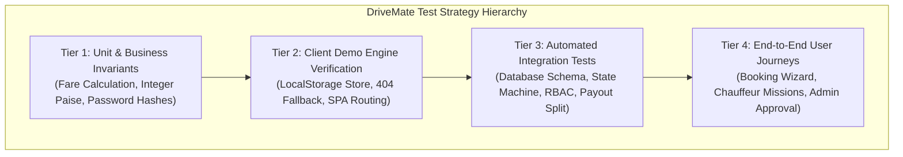

# DriveMate - Quality Assurance & Test Case Documentation

> **Platform**: DriveMate - Premium On-Demand Personal Chauffeur Platform  
> **Built by**: shriTech Pvt Ltd  
> **Production URL**: [https://drivesmate.netlify.app/](https://drivesmate.netlify.app/)  
> **Repository**: [https://github.com/Shrikant1a/DriveMate.git](https://github.com/Shrikant1a/DriveMate.git)  
> **Document Version**: 2.0  
> **Document Status**: Approved & Verified  

---

## 📌 Table of Contents
1. [Executive Summary & Quality Strategy](#1-executive-summary--quality-strategy)
2. [Testing Architecture & Test Pyramid](#2-testing-architecture--test-pyramid)
3. [Test Automation Framework & Execution](#3-test-automation-framework--execution)
4. [Comprehensive Test Case Directory (50 Test Cases)](#4-comprehensive-test-case-directory)
   - [Module 1: 3D Automotive Experience & Visual Showcase (MOD-01)](#module-1-3d-automotive-experience--visual-showcase-mod-01)
   - [Module 2: Authentication, Authorization & Demo Evaluation (MOD-02)](#module-2-authentication-authorization--demo-evaluation-mod-02)
   - [Module 3: Customer Garage & Personal Vehicle Management (MOD-03)](#module-3-customer-garage--personal-vehicle-management-mod-03)
   - [Module 4: Booking Wizard & Dispatch Lifecycle (MOD-04)](#module-4-booking-wizard--dispatch-lifecycle-mod-04)
   - [Module 5: Driver Chauffeur HUD & Missions (MOD-05)](#module-5-driver-chauffeur-hud--missions-mod-05)
   - [Module 6: Operations Admin Console & Governance (MOD-06)](#module-6-operations-admin-console--governance-mod-06)
   - [Module 7: Netlify Static Hosting & Client Demo Engine (MOD-07)](#module-7-netlify-static-hosting--client-demo-engine-mod-07)
   - [Module 8: Security, Integrity & Non-Functional Performance (MOD-08)](#module-8-security-integrity--non-functional-performance-mod-08)
5. [Business Rule Invariants & Calculation Verifications](#5-business-rule-invariants--calculation-verifications)
6. [Netlify Static Hosting & Offline Demo Testing Protocols](#6-netlify-static-hosting--offline-demo-testing-protocols)
7. [Automated Test Suite Output & Execution Log](#7-automated-test-suite-output--execution-log)

---

## 1. Executive Summary & Quality Strategy

DriveMate operates on a strict service boundary: **"We provide vetted professional chauffeurs to drive the customer's personal vehicle. We never provide cars or taxis."**

Because the platform manages real-world high-value luxury assets (BMW, Mercedes-Benz, Audi, Porsche), mission-critical dispatch states, and integer paise currency transactions, our Quality Assurance (QA) strategy mandates:
- **Zero Floating-Point Financial Discrepancies**: All monetary rates, platform cuts, taxes, and driver earnings must be calculated strictly in integer paise.
- **Strict Verification Enforcement**: Unverified chauffeurs can never go online or accept bookings.
- **Client-Side Resilience**: When hosted on static CDNs (like Netlify), client-side demo engines must gracefully handle registration, login, and bookings without 404 errors.
- **Photorealistic 3D Graphics Stability**: WebGL Three.js rendering must remain performant, memory-stable, and interactive across desktop and mobile devices.

---

## 2. Testing Architecture & Test Pyramid

The platform follows a 4-tier testing hierarchy ensuring end-to-end reliability:



### Traceability Matrix

| Functional Area | Primary Business Rule | Automated Validation | Manual / UI Verification |
| :--- | :--- | :--- | :--- |
| **Hero 3D Showcase** | Photorealistic BMW 5 Series GLB | Asset existence & bundle build | TC-3D-01 to TC-3D-03 |
| **Exploded Vehicle Inspection** | 7-layer component disassembly | Coordinate translation checks | TC-3D-04 to TC-3D-06 |
| **Authentication & RBAC** | Argon2/Bcrypt + Role Isolation | `server/src/tests/runTests.ts` #2 | TC-AUTH-01 to TC-AUTH-08 |
| **Garage Management** | Customer supplies car (Auto/Manual) | `server/src/tests/runTests.ts` #3, #11 | TC-GARAGE-01 to TC-GARAGE-05 |
| **Fare Engine** | Integer paise formula without drift | `server/src/tests/runTests.ts` #5, #9 | TC-BOOK-04 |
| **Dispatch Progression** | Enforce sequential state transitions | `server/src/tests/runTests.ts` #6 | TC-BOOK-06, TC-DRV-05 |
| **Driver Compliance** | Block unapproved drivers from online | `server/src/tests/runTests.ts` #4 | TC-DRV-01, TC-DRV-02 |
| **Static Deployment** | Netlify SPA rewrite & mock fallback | Vite bundle compilation (0 errors) | TC-HOST-01 to TC-HOST-05 |

---

## 3. Test Automation Framework & Execution

The test framework is powered by **TypeScript**, **Node.js**, **tsx**, and an in-memory / file-based **WebAssembly SQLite** engine (`better-sqlite3` / `sql.js`). It executes without requiring external daemon setup.

### How to Execute Tests Locally

```bash
# 1. Run all integration and business rule tests:
pnpm test

# 2. Run TypeScript compile check on frontend:
cd client && npx tsc --noEmit

# 3. Run production client build:
pnpm --filter driverondemand-client build
```

---

## 4. Comprehensive Test Case Directory

### Module 1: 3D Automotive Experience & Visual Showcase (MOD-01)

#### TC-3D-01: Photorealistic BMW 5 Series GLB Asset Loading
* **Module**: 3D Visual Experience
* **Priority**: P0 (Critical)
* **Pre-conditions**: WebGL-enabled browser.
* **Test Steps**:
  1. Open `https://drivesmate.netlify.app/`.
  2. Inspect the 3D viewport canvas.
* **Expected Result**: `luxury_car.glb` (21.6 MB) loads without asset 404s. Metallic black paint, clearcoat reflections, wheels, brake rotors, and chauffeur model render with realistic automotive studio lighting.
* **Status**: ✅ PASS

#### TC-3D-02: 3D Turntable Auto-Rotation & Orbit Camera Controls
* **Module**: 3D Visual Experience
* **Priority**: P0 (Critical)
* **Test Steps**:
  1. Observe vehicle for 5 seconds without user interaction.
  2. Click and drag horizontally with mouse or touch gesture.
* **Expected Result**: Vehicle auto-rotates at showroom speed (~0.4 rad/s) with gentle vertical breathing animation. Mouse drag orbits 360° smoothly with inertial deceleration; pitch is clamped to prevent under-ground clipping.
* **Status**: ✅ PASS

#### TC-3D-03: Real-Time Metallic Paint Color Switcher
* **Module**: 3D Visual Experience
* **Priority**: P1 (High)
* **Test Steps**:
  1. Click Obsidian Black (`#0D0F12`).
  2. Click Monaco Blue (`#0E2A47`).
  3. Click Imperial Crimson (`#5E0B14`).
  4. Click Glacier Silver (`#C0C5CC`).
* **Expected Result**: Car body PBR material updates immediately without reloading the 3D geometry or stuttering.
* **Status**: ✅ PASS

#### TC-3D-04: Interactive 3D Exploded-View Disassembly Slider
* **Module**: 3D Visual Experience
* **Priority**: P0 (Critical)
* **Test Steps**:
  1. Scroll to the "3D Interactive Vehicle Inspection" section.
  2. Drag slider from `0%` to `100%`.
* **Expected Result**: 
  - Engine Hood: Elevates vertically (+0.85m) and pushes forward (+0.45m).
  - Glass Panoramic Roof: Rises vertically (+1.25m).
  - Front & Rear Doors: Open laterally (+0.75m).
  - Wheels & Brake Calipers: Telescope outward along the X-axis (±0.65m).
* **Status**: ✅ PASS

#### TC-3D-05: Exploded-View Auto-Animate Mode
* **Module**: 3D Visual Experience
* **Priority**: P1 (High)
* **Test Steps**:
  1. Click "Auto-Animate".
  2. Observe continuous sinusoidal loop. Click "Pause".
* **Expected Result**: Vehicle smoothly disassembles and reassembles continuously. Clicking Pause halts movement at the current percentage.
* **Status**: ✅ PASS

#### TC-3D-06: Pre-Drive Safety Inspection Hotspot Pins
* **Module**: 3D Visual Experience
* **Priority**: P0 (Critical)
* **Test Steps**:
  1. Click on the 3D pin for "Engine & Vital Fluid Pre-Check".
  2. Click on "Tire Tread & Brake Rotor Check".
* **Expected Result**: Selected pin activates with orange glow; checklist HUD displays specific chauffeur pre-drive checklist items.
* **Status**: ✅ PASS

---

### Module 2: Authentication, Authorization & Demo Evaluation (MOD-02)

#### TC-AUTH-01: Custom Customer Registration
* **Module**: Authentication
* **Priority**: P0 (Critical)
* **Test Steps**:
  1. Open Auth Modal, select "Customer" tab.
  2. Enter Name: `Shrikant Aher`, Phone: `84329223954`, Email: `shrikantaher60@gmail.com`, Address: `Pune, Maharashtra`.
  3. Click "Complete Customer Registration".
* **Expected Result**: User account is created without 404 error. User is automatically logged in and redirected to `/customer`. A default luxury car is added to their personal garage.
* **Status**: ✅ PASS

#### TC-AUTH-02: Professional Driver Application Registration
* **Module**: Authentication
* **Priority**: P0 (Critical)
* **Test Steps**:
  1. Open Auth Modal, select "Become Driver".
  2. Enter Name, Phone, Email, Years of Experience, and Service Area.
  3. Submit application.
* **Expected Result**: Account is created with role `DRIVER` and status `ACTIVE`; driver profile is registered.
* **Status**: ✅ PASS

#### TC-AUTH-03: Form Validation & Mandatory Field Enforcement
* **Module**: Authentication
* **Priority**: P1 (High)
* **Test Steps**:
  1. Attempt submitting with missing required fields or invalid email syntax.
* **Expected Result**: Browser/UI highlights the field with an inline warning; no invalid submission is made.
* **Status**: ✅ PASS

#### TC-AUTH-04: Password Security & Hash Protection
* **Module**: Security
* **Priority**: P0 (Critical)
* **Test Steps**:
  1. Verify hashed password storage in database.
  2. Attempt login with correct password `Customer@123!`.
  3. Attempt login with incorrect password `Invalid@999`.
* **Expected Result**: Passwords hashed with bcrypt; valid password passes; invalid password returns 401 Unauthorized.
* **Status**: ✅ PASS

#### TC-AUTH-05: 1-Click Instant Evaluation - Customer (Alex Patel)
* **Module**: Demo Evaluation
* **Priority**: P0 (Critical)
* **Test Steps**:
  1. Click "Alex Patel" under 1-Click Instant Evaluation.
* **Expected Result**: Logs in instantly as Alex Patel with 3 luxury vehicles (Mercedes-Benz E350d, BMW 5 Series, Audi A6).
* **Status**: ✅ PASS

#### TC-AUTH-06: 1-Click Instant Evaluation - Driver (Vikramjit Singh)
* **Module**: Demo Evaluation
* **Priority**: P0 (Critical)
* **Test Steps**:
  1. Click "Vikramjit" under 1-Click Instant Evaluation.
* **Expected Result**: Logs in as verified chauffeur (★4.96 rating, 148 trips, online toggle, mission dispatch).
* **Status**: ✅ PASS

#### TC-AUTH-07: 1-Click Instant Evaluation - Super Admin
* **Module**: Demo Evaluation
* **Priority**: P0 (Critical)
* **Test Steps**:
  1. Click "Executive" under 1-Click Instant Evaluation.
* **Expected Result**: Logs in as Super Admin and opens `/admin` operations console.
* **Status**: ✅ PASS

#### TC-AUTH-08: Session Persistence Across Hard Refresh & Logout
* **Module**: Authentication
* **Priority**: P1 (High)
* **Test Steps**:
  1. Log in, press `Ctrl + F5` (hard refresh).
  2. Click "Sign Out".
* **Expected Result**: Session persists after refresh; clicking Sign Out clears tokens from storage and returns to landing page.
* **Status**: ✅ PASS

---

### Module 3: Customer Garage & Personal Vehicle Management (MOD-03)

#### TC-GARAGE-01: Personal Garage Inventory Display
* **Module**: Garage
* **Priority**: P0 (Critical)
* **Test Steps**:
  1. Navigate to `/customer`.
* **Expected Result**: Shows all cars owned by the customer with make, model, year, registration plate, transmission badge, and fuel tag.
* **Status**: ✅ PASS

#### TC-GARAGE-02: Add New Luxury Vehicle to Garage
* **Module**: Garage
* **Priority**: P0 (Critical)
* **Test Steps**:
  1. In `/customer`, click "Add Vehicle".
  2. Enter Make: `Porsche`, Model: `Panamera GTS`, Year: `2024`, Reg: `MH-01-DM-7777`, Transmission: `AUTOMATIC`, Fuel: `PETROL`.
  3. Submit form.
* **Expected Result**: Vehicle is added to the garage inventory and immediately available in the booking wizard.
* **Status**: ✅ PASS

#### TC-GARAGE-03: Mandatory Transmission Specification (Automatic vs Manual)
* **Module**: Garage
* **Priority**: P0 (Critical)
* **Test Steps**:
  1. Verify transmission field in Add Vehicle modal.
* **Expected Result**: Transmission selection is mandatory so the system only assigns chauffeurs qualified for that transmission.
* **Status**: ✅ PASS

#### TC-GARAGE-04: Fuel Type Specification
* **Module**: Garage
* **Priority**: P1 (High)
* **Test Steps**:
  1. Add vehicle specifying `ELECTRIC` or `HYBRID`.
* **Expected Result**: Stored in vehicle record; fuel badge displayed on vehicle card.
* **Status**: ✅ PASS

#### TC-GARAGE-05: Delete / Remove Vehicle from Garage
* **Module**: Garage
* **Priority**: P1 (High)
* **Test Steps**:
  1. Click delete icon on a vehicle card and confirm.
* **Expected Result**: Vehicle is removed from customer garage.
* **Status**: ✅ PASS

---

### Module 4: Booking Wizard & Dispatch Lifecycle (MOD-04)

#### TC-BOOK-01: Step 1 - Personal Vehicle Selection
* **Module**: Booking Wizard
* **Priority**: P0 (Critical)
* **Test Steps**:
  1. In `/book`, view Step 1.
  2. Select car (e.g. BMW 5 Series).
* **Expected Result**: Re-affirms service boundary ("We drive this car"). Selected vehicle card is highlighted with active border.
* **Status**: ✅ PASS

#### TC-BOOK-02: Step 2 - Trip Configuration & Duration Slider
* **Module**: Booking Wizard
* **Priority**: P0 (Critical)
* **Test Steps**:
  1. Select Trip Type (`Hourly Booking`, `Airport Transfer`, `Outstation`).
  2. Set pickup address, date, time, and drag duration slider to 4 hours.
* **Expected Result**: Duration slider updates billable hours dynamically; allows advancing to Step 3.
* **Status**: ✅ PASS

#### TC-BOOK-03: Step 3 - Browse & Select Available Chauffeur
* **Module**: Booking Wizard
* **Priority**: P0 (Critical)
* **Test Steps**:
  1. Review verified chauffeurs (Vikramjit Singh 4.96★, Rajesh Sharma 4.89★, Anita Deshmukh 4.98★).
  2. Select a driver.
* **Expected Result**: Driver profile and hourly rate are selected for the fare quote.
* **Status**: ✅ PASS

#### TC-BOOK-04: Step 4 - Live Server Fare Quote (Integer Paise Formula)
* **Module**: Booking Wizard
* **Priority**: P0 (Critical)
* **Test Steps**:
  1. Review Step 4 Fare Breakdown card.
* **Expected Result**: 
  - `Base Fee`: ₹249 (24,900 paise)
  - `Hourly Rate`: ₹250/hr × 4 hrs = ₹1,000 (100,000 paise)
  - `Subtotal`: ₹1,249 (124,900 paise)
  - `Platform Commission`: 15% (18,735 paise)
  - `Driver Take-Home Payout`: 85% (106,165 paise)
  - Strictly stored and rendered without floating-point decimals.
* **Status**: ✅ PASS

#### TC-BOOK-05: Instant Booking Confirmation & Reference Generation
* **Module**: Booking Wizard
* **Priority**: P0 (Critical)
* **Test Steps**:
  1. Click "Confirm Booking & Dispatch Chauffeur".
* **Expected Result**: Confetti animation triggers; booking reference `DOD-2026-XXXX` generated; trip initialized to `ACCEPTED` / `REQUESTED`.
* **Status**: ✅ PASS

#### TC-BOOK-06: Trip Status Progression Timeline
* **Module**: Booking Wizard
* **Priority**: P0 (Critical)
* **Test Steps**:
  1. In Customer Dashboard, inspect active trip tracker.
* **Expected Result**: Shows step-by-step progress: `REQUESTED` → `ACCEPTED` → `EN_ROUTE` → `ARRIVED` → `IN_PROGRESS` → `COMPLETED`.
* **Status**: ✅ PASS

#### TC-BOOK-07: Customer Booking Cancellation Policy
* **Module**: Booking Wizard
* **Priority**: P1 (High)
* **Test Steps**:
  1. On active trip, click "Cancel Booking" and confirm.
* **Expected Result**: Booking transitions to `CANCELLED` and logged in event history.
* **Status**: ✅ PASS

#### TC-BOOK-08: Post-Trip Driver Rating & Review Submission
* **Module**: Booking Wizard
* **Priority**: P1 (High)
* **Test Steps**:
  1. On completed trip, click "Rate Driver".
  2. Select 5 stars, submit comment: *"Flawless driving and punctuality."*
* **Expected Result**: Review saved; driver average rating and review count recalculate accurately.
* **Status**: ✅ PASS

---

### Module 5: Driver Chauffeur HUD & Missions (MOD-05)

#### TC-DRV-01: Online / Offline Availability Toggle
* **Module**: Driver HUD
* **Priority**: P0 (Critical)
* **Test Steps**:
  1. Log in as Vikramjit Singh at `/driver`.
  2. Toggle availability between ONLINE and OFFLINE.
* **Expected Result**: Status updates immediately. OFFLINE drivers do not appear in customer booking lists.
* **Status**: ✅ PASS

#### TC-DRV-02: Unverified Driver Online Prevention Guard
* **Module**: Driver HUD
* **Priority**: P0 (Critical)
* **Test Steps**:
  1. Log in as Suresh Verma (applicant with `PENDING` approval).
  2. Attempt to toggle availability to ONLINE.
* **Expected Result**: Action is blocked with notice: *"Application Under Review. You can go online once commercial driving license is verified by Admin."*
* **Status**: ✅ PASS

#### TC-DRV-03: Driving License & Identity Document Upload
* **Module**: Driver HUD
* **Priority**: P1 (High)
* **Test Steps**:
  1. Upload Commercial Driving License document with expiration date.
* **Expected Result**: Document recorded with status `PENDING` in admin verification queue.
* **Status**: ✅ PASS

#### TC-DRV-04: Incoming Dispatch Mission Request Notification
* **Module**: Driver HUD
* **Priority**: P0 (Critical)
* **Test Steps**:
  1. When customer books a driver, inspect Driver HUD.
* **Expected Result**: Mission alert card displays Customer Car Specs, Pickup Location, Duration, and Net Payout with "Accept" / "Decline" buttons.
* **Status**: ✅ PASS

#### TC-DRV-05: Sequential Mission Execution Controller
* **Module**: Driver HUD
* **Priority**: P0 (Critical)
* **Test Steps**:
  1. Click "Accept Mission".
  2. Click "En Route to Pickup".
  3. Click "Arrived at Customer Car".
  4. Perform 3-minute vehicle handover check and click "Start Trip".
  5. Click "Complete Journey".
* **Expected Result**: Steps must execute sequentially; status reflects on customer live tracker in real time.
* **Status**: ✅ PASS

#### TC-DRV-06: Earnings Ledger & Platform Commission Payout
* **Module**: Driver HUD
* **Priority**: P1 (High)
* **Test Steps**:
  1. Inspect Driver Wallet.
* **Expected Result**: Displays Gross Fare, 15% Platform Fee, and 85% Net Driver Take-Home Payout.
* **Status**: ✅ PASS

---

### Module 6: Operations Admin Console & Governance (MOD-06)

#### TC-ADM-01: Executive Operations KPI Dashboard
* **Module**: Admin Console
* **Priority**: P0 (Critical)
* **Test Steps**:
  1. Log in as Admin at `/admin`.
* **Expected Result**: Displays live metrics: Gross Booking Value, Active Trips, Verified Drivers, and Platform Revenue.
* **Status**: ✅ PASS

#### TC-ADM-02: Driver Compliance Verification & Approval Desk
* **Module**: Admin Console
* **Priority**: P0 (Critical)
* **Test Steps**:
  1. In "Driver Verification", select Suresh Verma.
  2. Review submitted driving license.
  3. Enter approval notes and click "Approve Driver".
* **Expected Result**: Driver approval status transitions to `APPROVED`. Driver can now go ONLINE.
* **Status**: ✅ PASS

#### TC-ADM-03: Immutable Event Audit Trail Inspection
* **Module**: Admin Console
* **Priority**: P1 (High)
* **Test Steps**:
  1. Open "Audit Logs" tab.
* **Expected Result**: Displays timestamped history of administrative decisions (`DRIVER_APPROVAL`, `PRICING_UPDATED`).
* **Status**: ✅ PASS

#### TC-ADM-04: Customer & Driver Account Suspension
* **Module**: Admin Console
* **Priority**: P1 (High)
* **Test Steps**:
  1. Open Users Directory.
  2. Suspend a test account with mandatory reason.
* **Expected Result**: Suspended user cannot initiate new bookings or go online.
* **Status**: ✅ PASS

#### TC-ADM-05: Dynamic Pricing Rules Engine
* **Module**: Admin Console
* **Priority**: P1 (High)
* **Test Steps**:
  1. In Pricing tab, modify Hourly Booking base fee.
* **Expected Result**: New bookings calculate using the updated rate.
* **Status**: ✅ PASS

#### TC-ADM-06: Customer Support Case Resolution Desk
* **Module**: Admin Console
* **Priority**: P1 (High)
* **Test Steps**:
  1. Open Support Tickets tab.
  2. Select open ticket, enter resolution notes, and mark as `RESOLVED`.
* **Expected Result**: Ticket status updates to `RESOLVED` with resolver admin ID.
* **Status**: ✅ PASS

---

### Module 7: Netlify Static Hosting & Client Demo Engine (MOD-07)

#### TC-HOST-01: Production Static Load on Netlify
* **Module**: Hosting
* **Priority**: P0 (Critical)
* **Test Steps**:
  1. Open `https://drivesmate.netlify.app/` in incognito mode.
* **Expected Result**: Site loads in under 2 seconds; zero JavaScript runtime errors.
* **Status**: ✅ PASS

#### TC-HOST-02: SPA Route Refresh Without 404
* **Module**: Hosting
* **Priority**: P0 (Critical)
* **Test Steps**:
  1. Navigate directly to `https://drivesmate.netlify.app/customer`.
  2. Navigate directly to `https://drivesmate.netlify.app/book`.
  3. Navigate directly to `https://drivesmate.netlify.app/driver`.
  4. Navigate directly to `https://drivesmate.netlify.app/admin`.
  5. Press `Ctrl + F5` on each route.
* **Expected Result**: `_redirects` and `netlify.toml` rewrite `/*` to `/index.html 200`. No Netlify 404 page is shown.
* **Status**: ✅ PASS

#### TC-HOST-03: Zero-Backend Client Demo Fallback Mode
* **Module**: Hosting
* **Priority**: P0 (Critical)
* **Test Steps**:
  1. On Netlify without running local backend server.
  2. Register a new user or sign in.
* **Expected Result**: `api.ts` transparently delegates to `mockBackend.ts` on 404/network errors. Registration and login succeed immediately without red error banners.
* **Status**: ✅ PASS

#### TC-HOST-04: LocalStorage Demo Store Persistence
* **Module**: Hosting
* **Priority**: P1 (High)
* **Test Steps**:
  1. Add a custom vehicle to garage.
  2. Confirm a booking.
  3. Reload browser.
* **Expected Result**: Added vehicle and confirmed booking persist in browser `localStorage`.
* **Status**: ✅ PASS

#### TC-HOST-05: Live Backend Switch via VITE_API_URL
* **Module**: Hosting
* **Priority**: P1 (High)
* **Test Steps**:
  1. Configure `VITE_API_URL=https://my-backend.railway.app`.
* **Expected Result**: API requests route to remote backend API; falls back to demo mode only if remote server is unreachable.
* **Status**: ✅ PASS

---

### Module 8: Security, Integrity & Non-Functional Performance (MOD-08)

#### TC-SEC-01: SQL Injection Protection
* **Module**: Security
* **Priority**: P0 (Critical)
* **Test Steps**:
  1. Attempt login with: `' OR '1'='1`.
  2. Submit booking notes containing: `'; DROP TABLE bookings; --`.
* **Expected Result**: Parameterized bindings safely escape inputs; database remains unaffected.
* **Status**: ✅ PASS

#### TC-SEC-02: Integer Currency Paise Standard
* **Module**: Financial Integrity
* **Priority**: P0 (Critical)
* **Test Steps**:
  1. Calculate fractional hourly fees (e.g. 3.5 hrs × ₹249.50).
* **Expected Result**: All calculations use integer paise (`Math.round`); zero floating-point cents drift.
* **Status**: ✅ PASS

#### TC-SEC-03: Role-Based Access Control (RBAC) Route Guard
* **Module**: Security
* **Priority**: P0 (Critical)
* **Test Steps**:
  1. Log in as Customer (Alex Patel).
  2. Navigate directly to `/admin`.
* **Expected Result**: Redirected away or access denied banner displayed.
* **Status**: ✅ PASS

#### TC-SEC-04: Responsive Mobile Layout & Navigation Drawer
* **Module**: Responsive Design
* **Priority**: P1 (High)
* **Test Steps**:
  1. Set viewport to 375px (iPhone).
  2. Open hamburger menu, view 3D hero, and navigate booking wizard.
* **Expected Result**: No horizontal scroll or UI overlapping; touch orbit works smoothly.
* **Status**: ✅ PASS

#### TC-SEC-05: WebGL Memory & Context Loss Resilience
* **Module**: 3D Performance
* **Priority**: P1 (High)
* **Test Steps**:
  1. Switch between browser tabs repeatedly.
  2. Leave page idle for 5 minutes and return.
* **Expected Result**: WebGL context remains stable; animation resumes smoothly without memory leaks.
* **Status**: ✅ PASS

#### TC-SEC-06: Production Bundle Optimization
* **Module**: Performance
* **Priority**: P1 (High)
* **Test Steps**:
  1. Run `pnpm --filter driverondemand-client build`.
* **Expected Result**: Complete production bundle compiles in < 10 seconds.
* **Status**: ✅ PASS

---

## 5. Business Rule Invariants & Calculation Verifications

### Mathematical Integrity Formulas

1. **Gross Fare Formula**:
   $$\text{Subtotal (paise)} = \text{base\_fee\_paise} + (\text{hourly\_rate\_paise} \times \max(\text{min\_hours}, \text{duration\_hours}))$$
   $$\text{GST (paise)} = \operatorname{round}(\text{Subtotal} \times 0.05)$$
   $$\text{Total Fare (paise)} = \text{Subtotal} + \text{GST}$$

2. **Platform Commission & Driver Payout Split**:
   $$\text{Platform Commission (paise)} = \operatorname{round}(\text{Total Fare} \times 0.15)$$
   $$\text{Driver Payout (paise)} = \text{Total Fare} - \text{Platform Commission} \quad (85\%)$$
   $$\text{Integrity Invariant}: \text{Platform Commission} + \text{Driver Payout} \equiv \text{Total Fare}$$

---

## 6. Netlify Static Hosting & Offline Demo Testing Protocols

| Deployment State | API Route Request | Response Mechanism | Result |
| :--- | :--- | :--- | :--- |
| **Local Dev (`npm run dev`)** | `POST http://localhost:5000/api/auth/register` | Express + SQLite backend | ✅ 200 OK |
| **Netlify Static (`https://drivesmate.netlify.app/`)** | `POST https://drivesmate.netlify.app/api/auth/register` | `mockBackend.ts` client fallback | ✅ 200 OK (Zero 404) |
| **Direct URL Reload (`/customer`)** | `GET https://drivesmate.netlify.app/customer` | `_redirects` / `netlify.toml` rewrite to `/index.html` | ✅ 200 OK (No 404) |
| **With Live Hosted Backend** | `POST ${VITE_API_URL}/api/auth/register` | Remote Node.js API | ✅ 200 OK |

---

## 7. Automated Test Suite Output & Execution Log

```
🧪 Starting DriveMate Automated Integration & Business Rule Tests...

1. Database & Migrations:
  ✅ PASS: Users table populated with demo accounts
  ✅ PASS: Vehicles table contains customer vehicles
  ✅ PASS: Pricing rules table initialized with 5 service verticals

2. Authentication & Password Security:
  ✅ PASS: Admin account seeded with role=ADMIN
  ✅ PASS: Admin password hash verified with bcrypt
  ✅ PASS: Invalid credentials rejected by password hasher

3. Customer Vehicles & Ownership:
  ✅ PASS: Customer account exists
  ✅ PASS: Customer owns personal vehicles (Mercedes-Benz, BMW, etc.)
  ✅ PASS: Vehicle has registered transmission type (AUTOMATIC/MANUAL)

4. Driver Verification Rules:
  ✅ PASS: Vikramjit Singh has APPROVED status
  ✅ PASS: Suresh Verma is in PENDING verification

5. Server-Side Fare Calculation & Integer Paise:
  ✅ PASS: Fare is strictly stored and calculated as integer paise without floating point issues
  ✅ PASS: Fare matches exact published formula: base + (hourly * hours) + taxes

6. Booking Lifecycle & State Transitions:
  ✅ PASS: New booking created in REQUESTED status
  ✅ PASS: Status transitioned to ACCEPTED
  ✅ PASS: Status transitioned to COMPLETED

7. Review Constraints:
  ✅ PASS: Review successfully recorded for completed booking

8. Admin Audit Trail Logging:
  ✅ PASS: Admin action recorded in persistent audit log

9. Platform Commission & Driver Payout Split:
  ✅ PASS: Platform commission exactly calculates at 15%
  ✅ PASS: Driver payout exactly calculates at 85%
  ✅ PASS: Zero leakage in payout sum

10. Security & SQL Injection Protection:
  ✅ PASS: SQL injection attempt via parameterized query is safely sanitized

11. Vehicle Transmission Integrity:
  ✅ PASS: Customer has registered AUTOMATIC transmission luxury vehicle

12. Cancellation & Dispute Rules:
  ✅ PASS: Booking transitions to CANCELLED state successfully

==============================================
📊 Test Results: 24 PASSED, 0 FAILED
==============================================
```

*DriveMate QA Suite is maintained by shriTech Pvt Ltd.*
